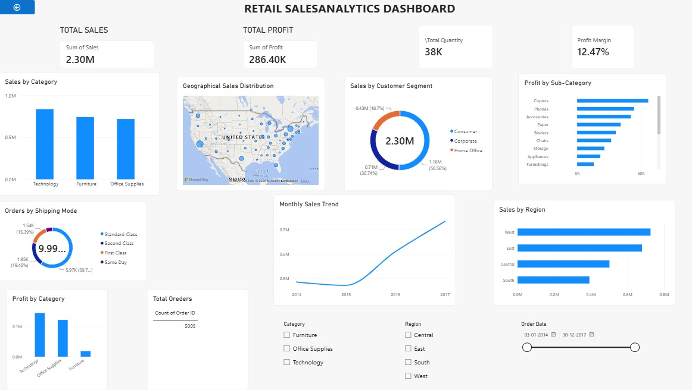

# Retail Sales & Business Performance Analytics

## Project Overview
An end-to-end Data Analytics project that analyzes retail sales data to identify business trends, evaluate profitability, and generate actionable business insights using Python, MySQL, and Power BI.

## Project Objectives
- Analyze overall sales and profit performance.
- Identify top-performing product categories.
- Compare sales across different regions.
- Understand customer segment contributions.
- Analyze shipping modes and product profitability.
- Track sales trends over time.

## Tools & Technologies
| Tool | Purpose |
|---|---|
| Python | Data cleaning and analysis |
| Pandas & NumPy | Data manipulation |
| Matplotlib & Seaborn | Data visualization |
| MySQL | SQL queries and business analysis |
| Power BI | Interactive dashboard |
| Jupyter Notebook | Python development |

## Dataset
**Sample Superstore Dataset**

The dataset contains retail order details, customer information, product categories, sales, profit, quantity, discount, shipping mode, and geographical information.

## Project Workflow
1. Dataset collection and exploration.
2. Data cleaning and preprocessing using Python.
3. Exporting cleaned data into CSV and Excel.
4. Importing data into MySQL.
5. Performing business analysis using SQL queries.
6. Developing an interactive Power BI dashboard.
7. Identifying key business insights.

## Key Performance Indicators

| KPI | Result |
|---|---:|
| Total Sales | 2,297,200.86 |
| Total Profit | 286,397.02 |
| Total Orders | 5,009 |
| Total Quantity | 37,873 |
| Profit Margin | 12.47% |

## Power BI Dashboard

The interactive dashboard includes:

- Sales by Category
- Geographical Sales Distribution
- Sales by Customer Segment
- Profit by Sub-Category
- Orders by Shipping Mode
- Monthly/Year-wise Sales Trend
- Sales by Region
- Profit by Category

Interactive filters are available for Category, Region, and Order Date.

## Key Business Insights
- Technology generated the highest sales among the three product categories.
- The West region recorded the highest sales.
- The Consumer segment contributed the largest share of sales.
- Overall profit margin was approximately 12.47%.
- Sales increased from 2015 through 2017.

## Project Structure
```text
Retail-Sales-Business-Analytics/
│
├── Dataset/
├── Python/
├── SQL/
├── PowerBI/
├── Screenshots/
├── Report/
└── README.md
```

## Conclusion
This project demonstrates an end-to-end data analytics workflow using Python, SQL, and Power BI. It transforms raw retail data into meaningful business insights and supports data-driven decision-making through interactive visualizations.

## Author
**Kiran Vijay Pawar**

Computer Engineering | Aspiring Data Analyst
## Dashboard Preview


## 🚀 Live Demo

Try the application here:

https://retail-analytics-pro.streamlit.app/
